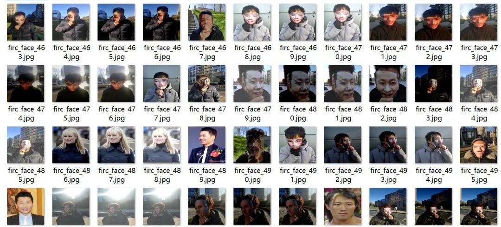
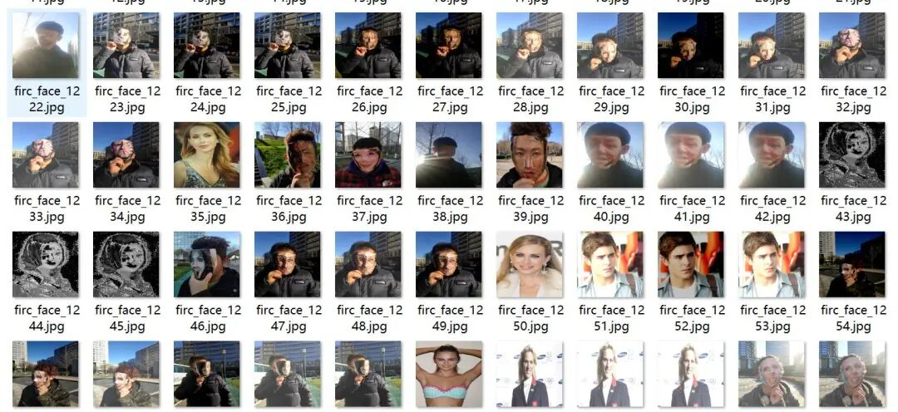
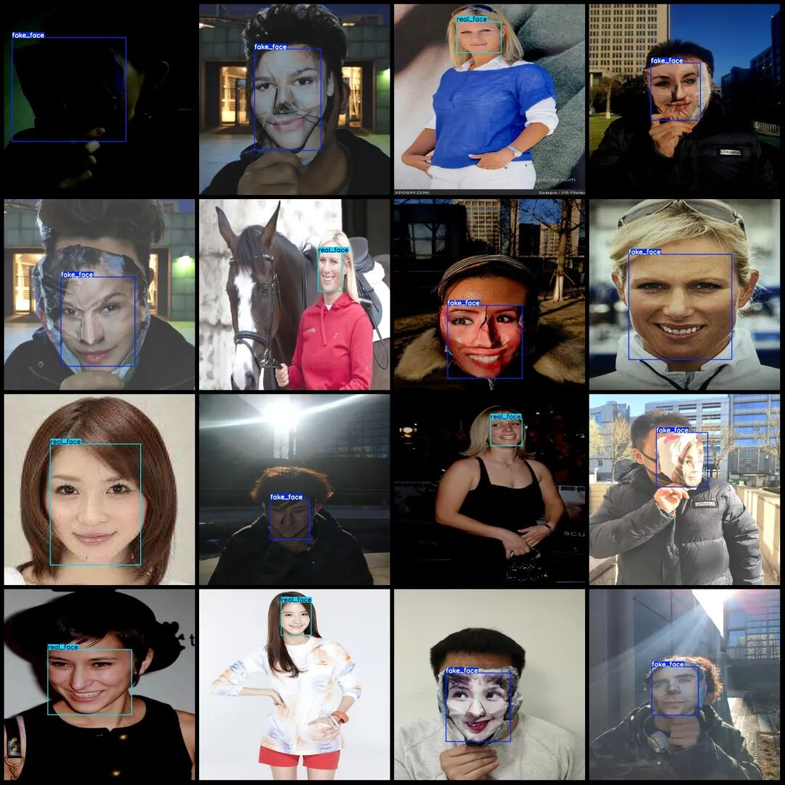

# Authentic and Fake Face Detection Pseudo Face Detection Dataset VOC+YOLO Format: 4520 Images in 2 Categories

Dataset format: Pascal VOC format + YOLO format (txt file without split path, only containing jpg images and corresponding VOC format xml files and yolo format txt files)

Number of images (number of jpg files): 4520

Number of annotations (number of xml files): 4520

Number of annotations (number of txt files): 4520

Labeling category count: 2

Label category names (Note that the order of categories in the Yolo format does not correspond to this, but is based on the labels folder's classes.txt): ["fake_face", "real_face"]

Number of boxes labeled in each category:

fake_face Frames = 3196

Real face box count = 1325

Total frame count: 4521

Using labelImg:

Annotation rules: Draw a rectangle around the category.

Important Notice: No

Image resolution: 1200x1200

Is the dataset enhanced? Yes, about one-third of it is original images, with the rest being enhanced images. The main enhancements are changes in contrast.

Special : This dataset does not guarantee the accuracy of the trained models or weight files.

Image Preview:

Annotation example:

## Payment

Here is a pay link on Stripe ( https://buy.stripe.com/3cs8yP7sY87d0vu9AB ). Please contact me lonlonago@foxmail.com after funding $89, and I will send you a complete data files , thank you!

